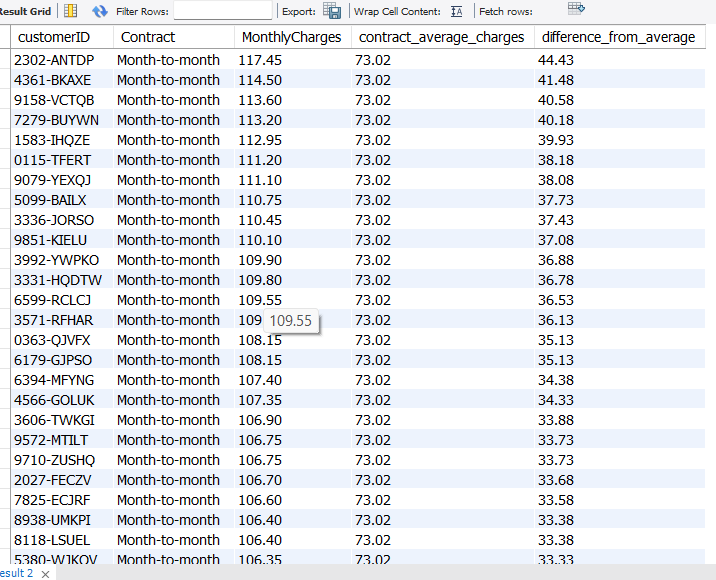

# Telecom Customer Churn Analysis

An exploratory analysis of customer churn in a telecommunications dataset. The project examines churn in relation to contract type, customer tenure, optional security and support services, and monthly charges. The findings below describe associations in the dataset; they do not establish that any factor causes customers to leave.

## Project contents

- `data/raw/README.md` — source dataset reference. The dataset itself is not included in this repository.
- `sql/analysis/` — SQL queries for the analyses described below.
- `sql/schema/` — schema directory.
- `images/` — analysis charts.

The dataset is the [Telco Customer Churn dataset on Kaggle](https://www.kaggle.com/datasets/blastchar/telco-customer-churn), as referenced in `data/raw/README.md`.

## Analysis questions and findings

| No. | Business question | Key findings | Business interpretation |
| --- | --- | --- | --- |
| 1 | What is the churn rate by contract type compared with the overall churn rate? | Month-to-month: **42.71%**; one-year: **11.28%**; two-year: **2.85%**. Overall: **26.58%**. | Month-to-month customers have the highest churn rate, **16.13 percentage points** above the overall rate. Two-year contract customers have the lowest churn rate, **23.73 percentage points** below the overall rate. |
| 2 | Do subscribers with shorter tenure churn at a meaningfully higher rate than long-tenure subscribers? | Short tenure: **47.68%** (1,037 of 2,175). Long tenure: **9.51%** (213 of 2,239). | The short-tenure churn rate is **38.17 percentage points** higher than the long-tenure rate, indicating that early customer retention is a significant challenge in this analysis. |
| 3 | Which combination of services is most associated with churn? | Customers without Online Security, Online Backup, Device Protection and Tech Support: **56.67%** churn (718 of 1,267). Customers subscribed to all four: **5.33%** (25 of 469). | Churn is substantially higher among customers without these additional services. Targeted service offers and support options could be investigated. |
| 4 | How do monthly charges for churned subscribers compare with the average for their contract type? | One-year contract average: **85.05**. Month-to-month contract average: **73.02**. The displayed churned customers have monthly charges above their respective contract averages. | Some displayed churned customers were paying considerably more than their contract-type averages. A grouped summary of all churned customers is still needed to establish the overall pattern. |

## Key churn risk signals

### Limited adoption of additional services

Customers without Online Security, Online Backup, Device Protection and Tech Support had a reported churn rate of **56.67%**, compared with **5.33%** among customers subscribed to all four services—a difference of **51.34 percentage points**. This association may help identify customers for whom the company could investigate relevant service offers and support options.

### Shorter tenure

Customers with tenure of 12 months or less had a churn rate of **47.68%**, compared with **9.51%** for customers with 49–72 months of tenure. The difference is **38.17 percentage points**. Early onboarding and engagement are possible areas for retention attention.

### Month-to-month contracts

The churn rate for month-to-month customers was **42.71%**, compared with **11.28%** for one-year contracts and **2.85%** for two-year contracts. The overall churn rate was **26.58%**.

### Monthly charges

The analysis reports contract-type average monthly charges of **85.05** for one-year contracts and **73.02** for month-to-month contracts. The displayed churned customers had charges above their respective contract-type averages. Because the comparison is based on displayed customers, a grouped summary of all churned customers is needed before drawing an overall conclusion about this pattern.

## Top 3 Customer Churn Risk Signals

The analysis revealed three major factors associated with higher customer churn.

**1. Customers without additional security and support services**

Customers who did not subscribe to Online Security, Online Backup, Device Protection and Tech Support recorded the highest churn rate of 56.67%. In comparison, customers subscribed to all four services had a churn rate of just 5.33%. This represents a difference of 51.34 percentage points. This suggests that customers without additional security and support services may be more vulnerable to churn. The company could explore targeted service offers and improved customer support to encourage greater service adoption.

**2. Customers with shorter tenure**

Customers with a tenure of 12 months or less recorded a churn rate of 47.68%, compared with 9.51% among customers who had stayed for 49–72 months. The difference of 38.17 percentage points highlights the challenges of retaining customers during the early stages of their relationship with the company. Improving customer onboarding, early engagement and service experience could help reduce customer losses.

**3. Customers on month-to-month contracts**

Month-to-month customers recorded a churn rate of 42.71%, significantly higher than the 11.28% recorded among one-year contract customers and the 2.85% recorded among two-year contract customers. The overall churn rate was 26.58%. This suggests that customers on flexible monthly contracts are more likely to leave. The company could consider introducing incentives to encourage customers to move to longer-term contracts.

## Customer Retention Intervention Recommendations

Based on the churn analysis, I recommend three targeted retention interventions to address the customer segments showing the highest likelihood of churn.

**1. Introduce targeted retention programmes for customers without additional security and support services**

Customers without Online Security, Online Backup, Device Protection and Tech Support recorded a churn rate of 56.67%, compared with 5.33% among customers subscribed to all four services.

**Recommended interventions:**

- Offer discounted bundles combining Online Security, Online Backup, Device Protection and Tech Support.
- Provide free trials or introductory discounts to encourage customers to experience additional services.
- Educate customers about the benefits of these services through personalised emails, SMS campaigns and customer support interactions.
- Monitor whether customers who adopt additional services demonstrate improved retention.

**Expected outcome:** Increase adoption of additional services and improve customer engagement, potentially reducing churn among customers with limited service subscriptions.

**2. Strengthen customer onboarding and early-stage engagement**

Customers with 12 months or less of tenure recorded a churn rate of 47.68%, compared with 9.51% among customers who had stayed for 49–72 months.

**Recommended interventions:**

- Introduce a structured onboarding programme for newly acquired customers.
- Follow up with customers during their first 30, 60 and 90 days to identify service problems and dissatisfaction.
- Provide dedicated customer support to new subscribers experiencing technical or billing difficulties.
- Introduce loyalty incentives for customers who reach important milestones, such as six and twelve months of subscription.
- Monitor early customer activity to identify potential dissatisfaction before customers decide to leave.

**Expected outcome:** Improve the early customer experience, strengthen customer relationships and reduce customer losses during the first year of subscription.

**3. Develop retention incentives for month-to-month contract customers**

Month-to-month customers recorded a churn rate of 42.71%, compared with 11.28% for one-year contracts and 2.85% for two-year contracts. The overall churn rate was 26.58%.

**Recommended interventions:**

- Offer discounted monthly rates to customers willing to move to one-year or two-year contracts.
- Introduce loyalty rewards for customers who maintain their subscriptions.
- Provide exclusive benefits or additional services to customers who commit to longer contract periods.
- Identify month-to-month customers with high monthly charges and offer suitable alternative packages.
- Conduct customer satisfaction follow-ups to understand why customers prefer flexible contracts.

**Expected outcome:** Encourage longer-term customer commitments, improve customer retention and reduce the high churn observed among month-to-month subscribers.

## Retention intervention recommendations

The findings support testing targeted interventions rather than assuming one approach will suit every customer segment. These are recommendations to evaluate, not proven outcomes.

1. **Explore service offers for customers without additional security and support services.** Consider discounted bundles, free trials or introductory discounts for Online Security, Online Backup, Device Protection and Tech Support. Explain the services through relevant customer communications and support interactions, and monitor adoption alongside subsequent churn.
2. **Strengthen onboarding and early-stage engagement.** Consider a structured onboarding journey, follow-ups during the first 30, 60 and 90 days, and timely help with technical or billing issues. Track early customer feedback and retention through the first year.
3. **Test retention incentives for month-to-month customers.** Evaluate whether suitable discounts, loyalty benefits or additional services encourage customers to choose longer-term contracts. Follow up with customers to understand their preferences, and consider package suitability when reviewing high monthly charges.

## Overall Conclusion

The findings suggest that customer churn is particularly concentrated among customers with shorter tenure, month-to-month contracts and limited subscriptions to additional security and support services. These factors provide useful signals for identifying customers who may require greater retention attention.

Based on these findings, the company should prioritise early customer engagement, improve awareness and adoption of additional services, and develop retention strategies for customers on month-to-month contracts.

It is important to note that these findings indicate associations with customer churn rather than proving that these factors directly cause customers to leave.

## Overall Recommendation

The company should adopt a targeted retention strategy rather than applying the same intervention to every customer. Priority should be given to customers with short tenure, month-to-month contracts and limited additional service subscriptions.

These characteristics can be combined to identify customers who may require early retention attention. The company should also monitor churn rates before and after implementing the interventions to determine whether the strategies are producing measurable improvements.

The recommendations are based on observed associations in the dataset. Their effectiveness should be evaluated through subsequent retention monitoring and controlled campaigns.

## Analysis files

- [`churnrate_by_contract_type.sql`](sql/analysis/churnrate_by_contract_type.sql)
- [`longVSshort_tenure_churnrate.sql`](sql/analysis/longVSshort_tenure_churnrate.sql)
- [`association_of_services_with_churnrate.sql`](sql/analysis/association_of_services_with_churnrate.sql)
- [`comparison_btwn_monthlycharges_and_contracttype.sql`](sql/analysis/comparison_btwn_monthlycharges_and_contracttype.sql)
