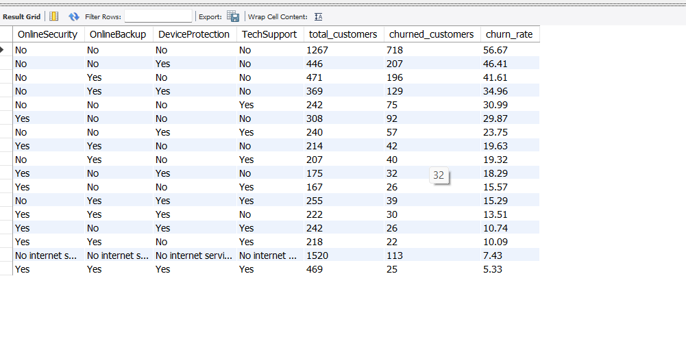
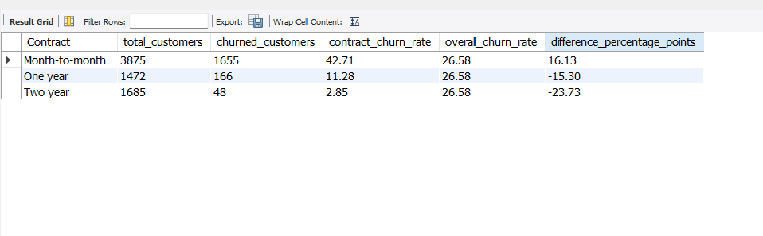

# Telecom Customer Churn Analysis

An exploratory analysis of customer churn in a telecommunications dataset. The project examines churn in relation to contract type, customer tenure, optional security and support services, and monthly charges. The findings below describe associations in the dataset; they do not establish that any factor causes customers to leave.

## Project contents

- `data/raw/README.md` — source dataset reference. The dataset itself is not included in this repository.
- `sql/analysis/` — SQL queries for the analyses described below.
- `sql/schema/` — schema directory.
- `images/` — analysis charts.

The dataset is the [Telco Customer Churn dataset on Kaggle](https://www.kaggle.com/datasets/blastchar/telco-customer-churn), as referenced in `data/raw/README.md`.

## Analysis questions and findings

| No. | Business question | Key findings | Business interpretation |
| --- | --- | --- | --- |
| 1 | What is the churn rate by contract type compared with the overall churn rate? | Month-to-month: **42.71%**; one-year: **11.28%**; two-year: **2.85%**. Overall: **26.58%**. | Month-to-month customers have the highest churn rate, **16.13 percentage points** above the overall rate. Two-year contract customers have the lowest churn rate, **23.73 percentage points** below the overall rate. |
| 2 | Do subscribers with shorter tenure churn at a meaningfully higher rate than long-tenure subscribers? | Short tenure: **47.68%** (1,037 of 2,175). Long tenure: **9.51%** (213 of 2,239). | The short-tenure churn rate is **38.17 percentage points** higher than the long-tenure rate, indicating that early customer retention is a significant challenge in this analysis. |
| 3 | Which combination of services is most associated with churn? | Customers without Online Security, Online Backup, Device Protection and Tech Support: **56.67%** churn (718 of 1,267). Customers subscribed to all four: **5.33%** (25 of 469). | Churn is substantially higher among customers without these additional services. Targeted service offers and support options could be investigated. |
| 4 | How do monthly charges for churned subscribers compare with the average for their contract type? | One-year contract average: **85.05**. Month-to-month contract average: **73.02**. The displayed churned customers have monthly charges above their respective contract averages. | Some displayed churned customers were paying considerably more than their contract-type averages. A grouped summary of all churned customers is still needed to establish the overall pattern. |

## Key churn risk signals

### Limited adoption of additional services

Customers without Online Security, Online Backup, Device Protection and Tech Support had a reported churn rate of **56.67%**, compared with **5.33%** among customers subscribed to all four services—a difference of **51.34 percentage points**. This association may help identify customers for whom the company could investigate relevant service offers and support options.

### Shorter tenure

Customers with tenure of 12 months or less had a churn rate of **47.68%**, compared with **9.51%** for customers with 49–72 months of tenure. The difference is **38.17 percentage points**. Early onboarding and engagement are possible areas for retention attention.

### Month-to-month contracts

The churn rate for month-to-month customers was **42.71%**, compared with **11.28%** for one-year contracts and **2.85%** for two-year contracts. The overall churn rate was **26.58%**.

### Monthly charges

The analysis reports contract-type average monthly charges of **85.05** for one-year contracts and **73.02** for month-to-month contracts. The displayed churned customers had charges above their respective contract-type averages. Because the comparison is based on displayed customers, a grouped summary of all churned customers is needed before drawing an overall conclusion about this pattern.

## Retention intervention recommendations

The findings support testing targeted interventions rather than assuming one approach will suit every customer segment. These are recommendations to evaluate, not proven outcomes.

1. **Explore service offers for customers without additional security and support services.** Consider discounted bundles, free trials or introductory discounts for Online Security, Online Backup, Device Protection and Tech Support. Explain the services through relevant customer communications and support interactions, and monitor adoption alongside subsequent churn.
2. **Strengthen onboarding and early-stage engagement.** Consider a structured onboarding journey, follow-ups during the first 30, 60 and 90 days, and timely help with technical or billing issues. Track early customer feedback and retention through the first year.
3. **Test retention incentives for month-to-month customers.** Evaluate whether suitable discounts, loyalty benefits or additional services encourage customers to choose longer-term contracts. Follow up with customers to understand their preferences, and consider package suitability when reviewing high monthly charges.

## Overall conclusion

In this analysis, churn is concentrated among customers with shorter tenure, month-to-month contracts and no subscription to the four named security and support services. These characteristics can inform which groups merit further retention attention. The monthly-charge comparison is more limited: the displayed churned customers were above their contract-type averages, but a summary covering all churned customers is needed to assess the broader pattern.

The results show associations, not proof of causation. Any intervention should be evaluated using subsequent retention monitoring; controlled campaigns can help assess whether a particular strategy is effective.

## Analysis files

- [`churnrate_by_contract_type.sql`](sql/analysis/churnrate_by_contract_type.sql)
- [`longVSshort_tenure_churnrate.sql`](sql/analysis/longVSshort_tenure_churnrate.sql)
- [`association_of_services_with_churnrate.sql`](sql/analysis/association_of_services_with_churnrate.sql)
- [`comparison_btwn_monthlycharges_and_contracttype.sql`](sql/analysis/comparison_btwn_monthlycharges_and_contracttype.sql)
